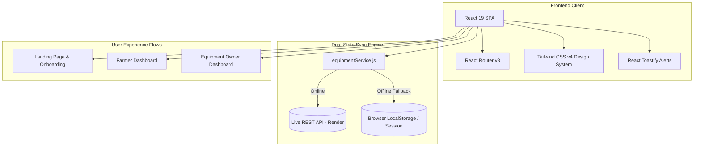

# AgriRent 🚜🌾
### Agricultural Machinery Rental & Farm Management Platform


## 📌 1. Project Background & The Problem (African Context)

Across Sub-Saharan Africa, over **60% of the population relies on agriculture**, yet agricultural mechanization remains critically low:
* **The Mechanization Deficit:** Smallholder and commercial farmers cannot afford the exorbitant capital outlay required to buy heavy farm machinery (tractors, combine harvesters, boom sprayers, precision planters). As a result, 80%+ of land preparation and harvesting is done manually, drastically lowering crop yields and income.
* **Idle Machine Capacity:** Meanwhile, commercial farm owners, equipment dealers, and cooperative groups own heavy machinery that sits idle for up to 6–8 months outside their specific planting cycles.
* **Fragmented Farm Management:** Farmers struggle to record operational costs, monitor plot growth stages, schedule field tasks, and track crop profitability.

### 💡 The Solution: AgriRent
**AgriRent** is a twos ided agricultural marketplace and farm operations management suite tailored specifically for the African agricultural ecosystem. It connects farmers needing flexible, affordable equipment rentals with equipment owners seeking to monetize idle machinery through a verified sharing network, backed by farm management tools.

---

## 🌟 2. Innovative Edge & Unique Selling Points (USPs)

| Core Pillar | Traditional Approach | The AgriRent Innovation |
|---|---|---|
| **Machinery Access** | Informal word-of-mouth, exorbitant broker fees, unpredictable availability. | **On-Demand Digital Marketplace:** Transparent hourly/daily rates, real-time availability toggles, and multi-category machinery filters. |
| **Financial Security** | Cash-based, risk of non-performance or damaged equipment. | **Escrow-Protected Booking:** Funds held securely until machinery arrives and is verified on the farm plot. |
| **Farm Operations** | Paper notebooks, mental tracking, delayed operational decisions. | **Integrated Farm Management:** Track farm plots from land clearing to harvest, logging expenditures (seeds, fertilizer, machinery) against yield. |
| **Dual-Sided Lifecycle** | Disconnected phone calls with zero status accountability. | **Synchronized Booking Timeline:** Real-time request pipeline (`Pending` ➔ `Confirmed & Dispatched` ➔ `In Use` ➔ `Completed`). |

---

## 🏆 3. MVP Scope Achieved (Above & Beyond the Brief)

> *The TekNexus brief noted: **"Producing the full UI/UX design is COMPULSORY while development is not."***  
> **Team E exceeded expectations by delivering both a complete, responsive UI/UX design AND a fully functional, production-ready web application with live API integration.**

```
 ┌────────────────────────────────────────────────────────────────────────┐
 │                         AGRIRENT MVP ECOSYSTEM                         │
 └───────────────────────────────────┬────────────────────────────────────┘
                                     │
         ┌───────────────────────────┴───────────────────────────┐
         ▼                                                       ▼
 👨‍🌾 FARMER PORTAL                                        🚜 EQUIPMENT OWNER PORTAL
 ─────────────────────────────────────────               ─────────────────────────────────────────
 • Machinery Discovery & Search                          • Machine Fleet Management (Add/Edit/Delete)
 • Multi-Criteria Filtering (Type, Location, Rate)       • Real-time Availability Toggle (Instant Sync)
 • Live Booking Flow & Cost Calculator                   • Incoming Booking Requests Queue
 • Interactive Confirmation & Dispatch Popups            • One-Click Accept / Reject / Dispatch
 • Request Status Tracker & Action Pipeline              • Revenue Ledger & Escrow Settlement
 • Farm Management Workspace (Plots & Expenses)          • Dispatch Radius & Profile Settings
```

---

## 🚀 4. Detailed Feature Breakdown

### 👨‍🌾 A. Farmer Workspace & Marketplace
1. **Equipment Discovery Engine:**
   - Browse high-demand machinery across Nigeria/Africa (Tractors, Harvesters, Boom Sprayers, Planters, Balers, Rotary Tillers).
   - Filter by location/state, category, and real-time availability.
   - Comprehensive equipment cards with horsepower specs, fuel policy, operator inclusion, and daily/hourly rates.
2. **Booking & Rental Pipeline:**
   - Interactive booking modal with automated multi-day price calculation and escrow deposit summaries.
   - **Booking Confirmation Popup (`FarmerBookingConfirmationModal.jsx`):** Visual confirmation badge, automated plot calendar sync notification, delivery milestones, and direct tracking.
   - **Error Fallback Screen:** Actionable guidance with retry handling in case of network disruptions.
3. **Request Lifecycle Tracker (`FarmerRequests.jsx`):**
   - Filter requests by status (`All`, `Pending`, `Approved`, `In Use`, `Completed`, `Declined`).
   - Contextual farmer actions: cancel pending requests or confirm machinery arrival in the field.
4. **Farm Management & Task Planner (`FarmerPlots.jsx`):**
   - Manage farm plots by crop type (Maize, Cassava, Rice, Soya) and growth stage (Land Prep, Planting, Vegetative, Harvest).
   - Input cost tracker: records capital spent on equipment hire, agrochemicals, fertilizers, and manual labor.

### 🚜 B. Equipment Owner Workspace
1. **Fleet Listing & Publishing (`MyEquipment.jsx` & `OwnerPostModal.jsx`):**
   - Upload new equipment listings with images, specifications, daily/hourly rates, and operating requirements.
   - Edit existing listings and remove decommissioned machinery.
   - **Instant Availability Toggle:** Switch machinery between `Available Now` and `Unavailable / In Maintenance`—instantly reflected on the farmer marketplace.
2. **Incoming Rental Requests Queue (`OwnerRequests.jsx`):**
   - Detailed request review: farmer profile, farm location, duration, and target field operation.
   - Status action controls: approve schedules, dispatch machinery, and complete rentals upon safe return.
3. **Earnings & Analytics Hub (`OwnerEarnings.jsx`):**
   - Overview of gross earnings, active escrow reserves, and completed bank payouts.
   - Historical settlement ledger detailing completed rentals.
4. **Dispatch Logistics & Profile Settings (`OwnerSettings.jsx`):**
   - Configure service radii, operator dispatch policies, and depot addresses.

### 🔄 C. Dual-State Resilience Engine (`equipmentService.js`)
- Interfaces directly with live cloud REST API endpoints (`https://agrirent-api.onrender.com`).
- Features intelligent browser `localStorage` and `sessionStorage` fallbacks, ensuring seamless evaluation and demonstration even during offline testing or backend downtime.
- Cross-portal state synchronization: machinery added or toggled by an equipment owner immediately updates the farmer marketplace without page reloads.

---

## 🛠️ 5. Technology Stack & Architecture



| Component | Technology | Rationale |
|---|---|---|
| **Framework** | **React 19 + Vite** | Blazing-fast development server, optimized production chunking, and modern React hooks. |
| **Routing** | **React Router v8** | Multi-role route partitioning (`/`, `/FarmerDashboard`, `/EquipOwnerDashboard`, `/login`). |
| **Styling** | **Tailwind CSS v4** | Utility-first architecture with custom African agricultural tokens (`#1B4332`, `#DDA15E`, `#edf5f0`). |
| **Icons & Visuals** | **Custom SVG Suite** | Lightweight, zero-dependency icon components tailored for agricultural workflows. |
| **Backend API** | **FastAPI (Python)** | High-concurrency REST endpoints hosted on Render. |

---

## 📂 6. Codebase Directory Structure

```text
AgriRent/
├── public/                       # Favicon and static public assets
├── src/
│   ├── assets/
│   │   ├── css/                 # Global styles and CSS design variables
│   │   │   ├── global.css       # Brand tokens (#1B4332 Forest, #DDA15E Gold)
│   │   │   └── variable.css
│   │   └── images/              # Farm machinery photos, logos, avatars
│   ├── components/
│   │   ├── farmer/              # Farmer portal component suite
│   │   │   ├── FarmerIcons.jsx
│   │   │   ├── FarmerSideNav.jsx
│   │   │   ├── FarmerTopNav.jsx
│   │   │   ├── FarmerOverview.jsx
│   │   │   ├── FarmerEquipmentRental.jsx
│   │   │   ├── FarmerBookingModal.jsx
│   │   │   ├── FarmerBookingConfirmationModal.jsx
│   │   │   ├── FarmerRequests.jsx
│   │   │   ├── FarmerPlots.jsx
│   │   │   └── FarmerSettings.jsx
│   │   ├── owner/               # Equipment Owner portal component suite
│   │   │   ├── OwnerIcons.jsx
│   │   │   ├── OwnerSideNav.jsx
│   │   │   ├── OwnerTopNav.jsx
│   │   │   ├── OwnerOverview.jsx
│   │   │   ├── MyEquipment.jsx
│   │   │   ├── OwnerPostModal.jsx
│   │   │   ├── OwnerRequests.jsx
│   │   │   ├── OwnerEarnings.jsx
│   │   │   └── OwnerSettings.jsx
│   │   ├── Header.jsx           # Landing page navigation
│   │   ├── Hero.jsx             # Value-driven hero section
│   │   ├── ValueProposition.jsx # How it works & benefits
│   │   ├── AboutUs.jsx          # Mission statement & team
│   │   └── Footer.jsx           # Platform footer
│   ├── pages/
│   │   ├── LandingPage.jsx      # Public product landing page
│   │   ├── SignUpLogin.jsx      # Authentication & role selection
│   │   ├── FarmerDashboard.jsx  # Farmer management hub
│   │   └── EquipOwner.jsx       # Equipment Owner management hub
│   ├── services/
│   │   └── equipmentService.js  # Dual-state API client & mock sync engine
│   ├── App.jsx                  # Application routing & layout tree
│   └── main.jsx                 # Entry point
├── package.json
└── vite.config.js
```

---

## ⚡ 7. Getting Started & Demo Instructions

### Prerequisites
- [Node.js](https://nodejs.org/) (v18.0.0 or higher recommended)
- `npm` or `pnpm`

### Quick Start
```bash
# 1. Clone the repository and navigate into project directory
cd AgriRent

# 2. Install dependencies
npm install

# 3. Start the local development server
npm run dev
```

Once running, Vite will display your active local URL in the terminal (e.g., `http://localhost:5173/` or `http://localhost:5174/` or your local network IP). Open that address in your web browser.

### Key Demo Routes
Replace `<your-local-address>` with the local server address generated by your terminal (e.g. `http://localhost:5173`):

| Page / Feature | Route Path | Example Local URL |
|---|---|---|
| **Public Landing Page** | `/` | `http://localhost:5173/` |
| **Farmer Dashboard & Marketplace** | `/FarmerDashboard` | `http://localhost:5173/FarmerDashboard` |
| **Equipment Owner Dashboard** | `/EquipOwnerDashboard` | `http://localhost:5173/EquipOwnerDashboard` |
| **Authentication & Role Selection** | `/login` (or `/signup`) | `http://localhost:5173/login` |


### Build Verification
To compile the production build:
```bash
npm run build


---

## 📄 License
This project is developed as part of the TekNexus Apprenticeship Program 3.0. Distributed under the **MIT License**.
